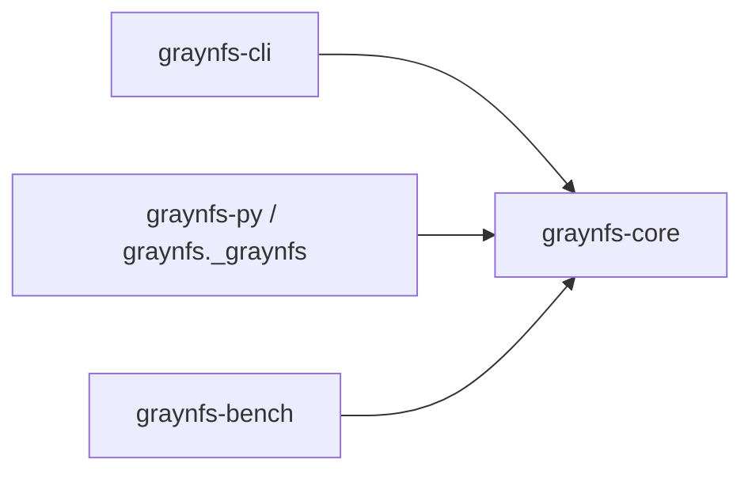
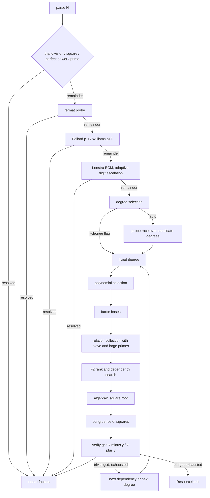

# GrayNFS · [](CHANGELOG.md) [](LICENSE.md) [](https://github.com/jake1104/GrayNFS/actions/workflows/ci.yml) [](python/graynfs/__init__.py)

Pure-Rust adaptive integer factorization: a GNFS core with a measured cascade to SIQS, ECM, and classical trial methods.

- **Adaptive cascade:** trial division, perfect powers, Fermat, Pollard p-1, Williams p+1, Brent Rho, Lenstra ECM, SIQS at degree 2, GNFS at degrees 3-5. Measured cost picks the winner; the fastest correct answer wins.
- **Verified output:** every reported factorization is product-checked before it is returned. A wrong answer is a hard failure, never a slow one.
- **Budgets as errors:** time (`--timeout-seconds`) and memory (`--max-memory-mb`, default 1 GiB) end runs with a clean `ResourceLimit`, never an abort.
- **Reproducible bench:** every bench JSON is an archive envelope carrying its own provenance (task ID, tier, timeout, threads, seeds, timestamp).

The numeric backend is `num-bigint` / `num-traits` (no GMP: the Windows MSVC linker cannot build it). The CLI binary uses `mimalloc` by default; the Python wheel is unaffected.

- [Quick start](#quick-start)
- [Installation](#installation)
- [Usage](#usage)
- [Architecture](#architecture)
- [Benchmarks](#benchmarks)
- [Correctness](#correctness)
- [Building](#building)
- [Release notes](#release-notes-v012--2026-10-18)
- [Contributing](#contributing)
- [License](#license)

## Quick start

```powershell
cargo build -p graynfs-cli --release
.\target\release\graynfs.exe 100160063
```

```text
N: 100160063
method: fermat
degree: n/a
factors: 10007 * 10009
relations: 0
rank: 0
elapsed_ms: 2
```

```python
>>> import graynfs
>>> graynfs.factor(100160063)
[10007, 10009]
```

## Installation

Prerequisites: a Rust stable toolchain plus a C compiler (the default allocator builds C sources; `--no-default-features` skips it), Python 3.8 or later, and maturin for the wheel.

```powershell
cargo build -p graynfs-cli --release
.\target\release\graynfs.exe 1000036000099
python -m maturin build --release --out dist
python -m pip install --force-reinstall --no-deps dist\graynfs-0.1.3-cp38-abi3-win_amd64.whl
```

## Usage

CLI:

```text
> graynfs.exe 100160063 --timings
N: 100160063
method: fermat
degree: n/a
factors: 10007 * 10009
relations: 0
rank: 0
elapsed_ms: 1
stage: fermat               degree: n/a  elapsed_ms: 0        divisor=10007
```

Python:

```python
import graynfs

graynfs.factor(100160063)                       # [10007, 10009]
graynfs.factor(100160063, degree=3)             # [10007, 10009]
graynfs.is_probable_prime(10007)                # True
graynfs.version()                               # '0.1.3'
graynfs.stage_timings(100160063, degree=3)      # [{'stage': 'fermat', ...}]
```

All three outputs above were verified live against the installed 0.1.3 wheel.
`graynfs.factor` and `graynfs.factor_with_progress` accept `degree: int | None
= None` (auto-select), `rational_base_bound`, `algebraic_base_bound`,
`sieve_a_bound`, `sieve_b_bound`, `timeout_seconds` (`None` = no deadline),
`max_memory_mb` (`None` = 1 GiB budget), `allow_fallback`, and the toggles
`use_fermat`, `use_squfof`, `use_pm1`, `use_pp1`, `use_ecm`, `use_mpqs`
(default `True`), all keyword-only after `n`. `threads: int | None = None`
selects the worker count (default: all logical cores); `perf_mode: bool =
False` marks timing records without changing behavior. Factors return in
ascending order. `factor_with_progress(n, callback, ...)` calls `callback`
with `{stage, current, total, message}` per stage boundary; a non-callable
callback raises `TypeError`. `stage_timings(n, *, ...)` returns `[{stage,
degree, elapsed_ms, detail}]`. Errors surface as `ValueError` with the CLI
category text (`resource-limit: ...`); bad types raise `TypeError`. The Rust
computation releases the Python GIL, so concurrent `factor` calls overlap.

### Full CLI flag table

| flag | default | meaning |
| :--- | :------ | :------ |
| `--degree` | auto | force a fixed polynomial degree (see Degree selection below) |
| `--rational-base-bound` | 2000 | bound of the rational factor base |
| `--algebraic-base-bound` | 2000 | bound of the algebraic factor base |
| `--sieve-a-bound` | 700 | sieve bound on `a` |
| `--sieve-b-bound` | 120 | sieve bound on `b` |
| `--large-prime-bound` | 50000 | upper bound of a residual large prime |
| `--timeout-seconds` | 60 | overall budget; on expiry the run ends with a clean `ResourceLimit` and a non-zero exit |
| `--max-memory-mb` | unset (1 GiB budget) | cap estimated sieve and matrix memory in MiB before allocating; exceeded estimates fail cleanly with `ResourceLimit` instead of allocating |
| `--no-fallback` | off | disable the Pollard-Rho fallback |
| `--skip-preprocessing` | off | skip trial division and the Fermat/p-1/p+1/ECM probes; the perfect-square and perfect-power reductions still run |
| `--double-large-primes` | off | keep relations carrying two or three large primes and pair them cyclically; raises the yield on very large inputs but slows collection at smaller ones |
| `--no-fermat` | off | skip the Fermat close-factor probe |
| `--no-squfof` | off | reserved; no Squfof stage is currently landed |
| `--no-pm1` | off | skip Pollard p-1 |
| `--no-pp1` | off | skip Williams p+1 |
| `--no-ecm` | off | skip Lenstra ECM |
| `--no-mpqs` | off | route degree 2 to the classic single-polynomial QS path instead of SIQS |
| `--timings` | off | print a per-stage timing breakdown |
| `--threads` | all logical cores | worker thread count for the parallel stages |
| `--perf-mode` | off | mark timing records as performance-mode runs without changing factorization behavior |
| `--json` | off | emit the result as a single JSON object on stdout |

Bounds left at the defaults are auto-scaled by a digit-indexed parameter table
for inputs above 36 digits (memory-bounded to 1 GiB with a clean
`ResourceLimit`); passing any bound explicitly keeps it. The 37-60 digit rows
share one uncapped table entry, and the degree-2 collect loop also escalates
the sieve width on starvation (measured `InsufficientRelations` rounds only,
explicit flags still win).

The report prints the input, the method, the selected degree, the verified
factors, the relation count, the matrix rank, and the elapsed milliseconds.
Exit code is 0 on success and non-zero on failure. A failed run prints
`error: <category>: <detail>` on stderr (verified: `error: input: invalid
decimal integer: ...` for `abc`; `error: resource-limit: ...` on budget
expiry), where `category` is one of `input`, `resource-limit`,
`cancelled`, or `internal`. With `--timings`, stage records print on stdout
even for failed runs. With `--json` the same fields are emitted as a single
JSON object with keys `input`, `method`, `degree` (nullable), `factors`,
`relations`, `rank`, and `elapsed_ms`, plus a `timings` array of `{stage,
degree, elapsed_ms, detail}` only when `--timings` is also passed. A failed
run instead emits `{"error": {"category": ..., "detail": ...}}` and exits
non-zero. Verified output:

```json
{"degree":null,"elapsed_ms":1,"factors":["10007","10009"],"input":"100160063","method":"fermat","rank":0,"relations":0}
```

### Degree selection

`FactorOptions::degree` is `Option<usize>`: `None` selects automatically,
`Some(d)` forces degree `d`. `candidate_degrees` derives candidates from the
bit length of $N$:

| bit length of $N$ | candidates |
| :---------------- | :--------- |
| $\le 32$ | `[2]` |
| $\ge 36$ | `[2, 3]` |
| $\ge 44$ | `[2, 3, 4]` |
| $\ge 60$ | `[2, 3, 4, 5]` |

A single candidate runs directly. Otherwise the candidates race: each receives
a slice of `degree_race_fraction` (default `0.2`) of the remaining budget,
and the first verified divisor wins immediately. The probe bound is

$$B(N) = \exp\left((\ln N)^{1/3}\,(\ln\ln N)^{2/3}\,(64/9)^{1/3}\right)$$

seconds, clamped to one hour, used only when no deadline is configured (the
Python default). If every candidate exhausts its slice, the lowest degree
that ran out of time is re-run with the full remaining budget.

## Architecture



| crate | role |
| :---- | :--- |
| `graynfs-core` | factorization library: adaptive cascade (`cascade`, `pm1`, `ecm`), preprocessing, sieving (SIQS degree 2 with QS fallback, GNFS degrees 3-5), F2 linear algebra, algebraic square root, record-only SNFS special-form detector |
| `graynfs-cli` | `graynfs <N>` command-line front end |
| `graynfs-py` | PyO3 extension module exposed as the `graynfs` Python package |
| `graynfs-bench` | benchmark tiers with per-case deadlines and JSON output |



## Benchmarks

Method: default release build (mimalloc default-on), 16 threads, i5-1340P,
measured 2026-10-17 unless noted. Medians of 5 runs; sub-second deltas under
~30 ms and multi-second deltas under ~10% are noise. Every bench run writes its
raw per-case observations to the `--output` JSON file (default
`logs/graynfs-benchmark.json`, local-only) as an archive envelope carrying
its own provenance (`task_id`, tier, timeout, threads, seeds, timestamp).

| case | winner | elapsed |
| :--- | :----- | :------ |
| `770817968652704265841785071059` 100-bit SIQS | SIQS 1878/945 | 229 ms median (208-233 of 3) |
| 267-bit with a 21-digit factor | ECM | 859 ms median (663/859/1024 at curves=112; YAFU historical ~836 median of 5) |
| `3426790303412814276981061` 82-bit | default p-1 | ~12 ms |
| hostile far-apart 105-bit | forced degree-2 3269/907 | ~2.2 s median (full cascade wins via ECM in ~205 ms) |
| 267-bit at `--timeout-seconds 1` | ECM | historical 5/5 (393-473 ms); re-verified 3/5 (676-692 ms, n=5) |

### Full benchmark tables

Degree 2 is SIQS (self-initializing polynomials over the QS sieve infra:
target `A ≈ 2^(n_bits/2 + 1 - interval_bits)`, CRT-built `B` with `B² ≡ N
(mod A)`, per-attempt base/sieve expansion x2 up to 4 attempts, and
one-large-prime pairing preserving `a² ≡ value (mod n)`). The MR primality
test on residuals is gated behind `rest ≤ large_prime_bound`. On starvation
(measured `InsufficientRelations` rounds only) the collect loop escalates the
sieve width over a fixed grid at the default LP bound.

| case | flags | relations | rank | elapsed |
| :--- | :---- | :-------- | :--- | :------ |
| `1000036000099 = 1000003 * 1000033` | default | n/a (preprocessing win, no sieve) | n/a | 0 ms, Fermat win (single) |
| `100160063 = 10007 * 10009` | `--skip-preprocessing --degree 3` | 604 | 293 | 120 ms historical row, kept for reference |
| `1155285037654380637 = 1074741869 * 1074941873` | `--skip-preprocessing --degree 3` | 3682 | 2422 | 1702 ms total, collect 1133 ms, rank 56 ms (single) |
| `100160063 = 10007 * 10009` | `--skip-preprocessing --degree 4` | 934 | 549 | 225 ms (single) |
| `4606404410723 = 2048581 * 2248583` | `--skip-preprocessing --degree 5` + bounds below | 4265 | 2810 | 8224 ms total, collect 519 ms, rank 64 ms (single) |
| `770817968652704265841785071059` | `--skip-preprocessing --degree 2` | 1878 | 945 | total 208-233 ms, median 229 (of 3) |
| `3426790303412814276981061` | `--skip-preprocessing --degree 2` | 301 | 251 | 35 ms total (single) |
| `35658606617546370626847644936101` hostile far-apart | `--skip-preprocessing --degree 2` | 3269 | 907 | 2174 ms median (of 3) |

The deg5 row used `--rational-base-bound 4000 --algebraic-base-bound 20000
--sieve-a-bound 72000 --sieve-b-bound 8000`.

| case | winner | elapsed |
| :--- | :----- | :------ |
| `1000036000099 = 1000003 * 1000033` (close) | Fermat | 0 ms (single) |
| `1155285037654380637` 61-bit | Fermat | 0 ms (single; GNFS path: 1702 ms at 3682/2422) |
| `726421589145731 = 5467499 * 132861769` | p+1 after Fermat/p-1 misses | 753 ms historical row |
| `28336447260686263324663` 76-bit | p+1 | 3191 ms historical row |
| 267-bit (above) | ECM after Fermat/p±1 misses | 859 ms median (of 3) |
| same 267-bit at `--timeout-seconds 1` | ECM | 5/5 wins, 393-473 ms (historical) / 3/5 wins, 676-692 ms (re-measured 2026-10-17) |
| `768805586871186146129` 70-bit | SIQS | 27 ms historical row |
| `3426790303412814276981061` 82-bit | SIQS forced route / p-1 default route | 35 ms / 12 ms (single) |
| `768805586871186146129` 70-bit | p-1 after Fermat miss | 13 ms (single) |

External reference (YAFU 3.1.9 static AVX2, 16 threads, identical inputs;
gray side re-measured 2026-10-17, release, 16 threads, medians of 3; YAFU
side NOT re-run — no YAFU binary this round, so YAFU figures are historical
values from the archived 2026-10-17 5-run set (measurement logs, not shipped in git)):
100-bit forced-SIQS gray 229 ms median (208/229/233) vs YAFU historical
157-218 ms (median ~179 of 5), a tie within YAFU's own spread. Demo267 gray
859 ms median (663/859/1024) vs YAFU historical ~836 ms median of 5 (559-1198).

### 267-bit repro case

The `stress` tier ends with `repro_267`, the 267-bit ECM input
`166871515843890537614148105919789085907512212182703922830333764223351416812060867`
($121680281986369904489 \times 1371393237423486234387340775961402466614689310566958802486603$,
product-verified). It carries its own 60 s deadline regardless of
`--timeout-seconds`, and every bench run writes its raw per-case observations
to the `--output` JSON file as an archive envelope: top-level provenance
(`task_id`, `tier`, `timeout_seconds`, `threads_requested`,
`threads_effective`, `case_filter`, the `random_*` seed settings, and
`timestamp_unix_secs`) plus the `observations` array. `--task-id` labels the
envelope.

```powershell
target\release\graynfs-bench.exe --tier repro267 --timeout-seconds 60 `
  --task-id repro267 `
  --output bench-repro267.json
```

Measured 2026-10-17 (release, 16 threads): `repro_267` status ok, verified
true, method `ecm`, total ~715 ms against the 60 s per-case deadline.

### Limits

The square-root tail is mechanically bounded: a 12 s per-attempt ceiling
(`ATTEMPT_CEILING_MS`, verified-gcd soundness kept) cut the deg3-skip median
5.1x. Degree 6 is implemented and unit-tested but deliberately not a
candidate (Dickman parameter $u \approx 10$, $\rho(u) \approx 10^{-11}$).
The SIQS wall stood between 100 and 105 bits; starvation-gated width
escalation closed the 105-bit cell (3269/907 in ~2.2 s median on the
forced-degree-2 route), while 110-bit+ and 90-digit inputs remain out of
reach (smoothness wall). Lattice sieving is not implemented. There are no
absolute bit-size dispatch boundaries: budgets are fractional slices of the
remaining time and escalation follows measured cost. The cascade splits work
by factor character: smooth `p-1`/`p+1` to Pollard/Williams, close factors to
Fermat, small factors to Brent Rho and ECM (Montgomery XZ, PRAC chains,
unrolled REDC, prime-only stage-2 BSGS, 16-thread curves, stage-2 cap 16M),
balanced mid-size inputs to the siever or the GNFS degree race, leftovers to
the Rho fallback. The memory budget is an estimate-based soft guard, not an RSS hard limit.

## Correctness

```powershell
cargo test --workspace
python -m pytest -q python/tests
```

Every bench and every run self-checks the product before reporting success, with final factors product-verified under probabilistic primality.
`graynfs-bench --tier random` generates reproducible semiprimes with a seeded
SplitMix64 generator and verifies every answer:

```powershell
target\release\graynfs-bench.exe --tier random --random-count 60 `
  --random-min-factor-bits 16 --random-max-factor-bits 24 --timeout-seconds 180
```

Sixty cases spanning 34 to 48 bits all factor correctly on earlier trees, and
no case ever produced a wrong answer: every failure was a clean
`ResourceLimit`. Re-verified on the current tree 2026-10-17: far-apart 16/16
and random 35/35, zero failures, all products verified.

## Building

```powershell
cargo fmt --all
cargo clippy --workspace --all-targets -- -D warnings
cargo test --workspace
```

`mimalloc` is the default allocator for `graynfs-cli`. Single-machine
evidence only. Opt out explicitly:

```powershell
cargo build -p graynfs-cli --release --no-default-features
```

## Release notes (v0.1.3 — 2026-10-18)

0.x carries no compatibility promise.

Breaking changes:
- `FactorReport.method` gains `prime`, `perfect_square`, and `perfect_power` values on the early-exit paths.
- Bench `run_id` format is now `{task-id}-{nanos}-{pid}-{seq}` with a per-process monotonic sequence.
- Bench observations report `verification_failed` instead of `ok` when the product check fails.
- Perfect-power detection now terminates on large inputs (previously hung above ~80 bits), so large-input runs complete instead of stalling.

Other notes:
- Mid-collection `ResourceLimit` guard: live memory estimates with checkpoints in the GNFS/SIQS collect loops fail cleanly instead of allocating.
- Over-budget sieve workers stop early at batch boundaries without contaminating the retry loop.
- SIQS live-budget deduplication removes one redundant check with no behavior change.
- CI gates on the version-drift guard plus a separate `gnfs-degrees` release job.

## Release notes (v0.1.2 — 2026-10-18)

0.x carries no compatibility promise.

Behavior notes (all previously silent, now explicit):
- `FactorReport.method` strings report the sieve stage that actually won:
  `siqs` on the SIQS path, `quadratic-qs` on the classic quadratic-sieve
  path, `trial_division` on the trial-division early-return path; degree 3+
  still reports `gnfs`.
- The memory estimator now counts relation storage scaled by mask width
  (`estimate_total_bytes`), so large-column matrices fail cleanly with
  `ResourceLimit` where the old underestimate would have allocated.
- Bench archive envelopes carry a per-run unique `run_id`
  (`<task-id>-<timestamp>`); `commit_or_id` stays the task ID.
- CI quarantine stays non-blocking and explicit
  (`quarantine-105bit-release-info (non-blocking, does-not-gate-release)`,
  `continue-on-error: true`, release-only `--ignored` 105-bit filter).

## Release notes (v0.1.1 — 2026-10-17)

0.x carries no compatibility promise.

Breaking changes (all three previously silent, now explicit):
- `FactorReport.method` strings report the stage that actually won
  (e.g. `fermat`, `pm1`); the old `preprocessing` label is gone.
- Python `ValueError` messages are now `"category: detail"` prefixed
  (e.g. `resource-limit: ...`), matching the CLI `error: <category>:
  <detail>` shape.
- Previously silently accepted inputs are now hard errors:
  `use_squfof=false`, out-of-range `degree`, and a degree-race fraction
  below `0.05`.

Headline improvements since v0.1.0: memory-budget API (`memory_budget_bytes` /
`--max-memory-mb` / `max_memory_mb` with clean `ResourceLimit` failures),
single thread-budget propagation through every parallel stage, stabilized
4-way error taxonomy (`input` / `resource-limit` / `cancelled` / `internal`)
across core, CLI, JSON and Python, local gate script (`gate.ps1`), and the
quarantine policy for the debug-slow 105-bit boundary test (release-only
`--ignored` gate).

## Release notes (v0.1.0 — 2026-10-17)

First release. Integer factorization through an adaptive cascade (trial
division, perfect powers, Fermat, Pollard p-1/p+1, Brent Rho, Lenstra ECM,
SIQS at degree 2, GNFS at degrees 3-5) around a GNFS core, with a CLI and a
Python binding. Pure-Rust arithmetic, default allocator mimalloc, MIT
licensed. Install from [Installation](#installation).

Measured (i5-1340P, 16 threads): 100-bit SIQS 208-233 ms, median 229 (of 3);
267-bit ECM case 663-1024 ms, median 859 (of 3) (same input: YAFU 3.1.9
historical ~836 ms median of 5, archived 2026-10-17 runs); 82-bit default
route ~12 ms; 105-bit hostile semiprime ~2.2 s; tight 1 s budget on the
267-bit case won 5/5 on the earlier tree (historical; 3/5 on the 2026-10-17
re-verification). Every reported factorization is product-verified before it
is returned.

Known limits: hostile inputs past ~105 balanced bits and all tested 90-digit
inputs are out of reach (smoothness wall); all timings are single-machine
evidence; Windows MSVC is the tested toolchain.

## Contributing

- Report bugs and request features via [issues](https://github.com/jake1104/GrayNFS/issues).
- Review [pull requests](https://github.com/jake1104/GrayNFS/pulls) and the benchmark method notes before trusting a timing row.
- Build and test locally first (`cargo fmt --check`, `cargo clippy --workspace --all-targets -- -D warnings`, `cargo test --workspace`, `cargo build --release`); see `gate.ps1 -Full` for the full local gate including the wheel and the release-only quarantine test.
- Keep changes minimal and measured: one behavior per task, with the commands and outputs that prove it.

## License

MIT (see `LICENSE.md`).
