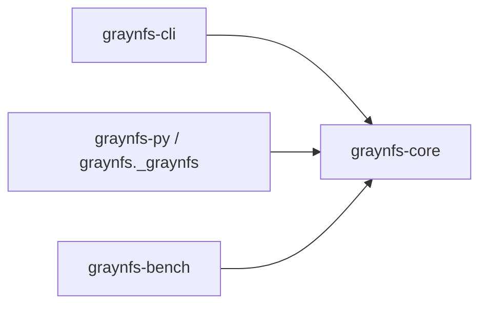
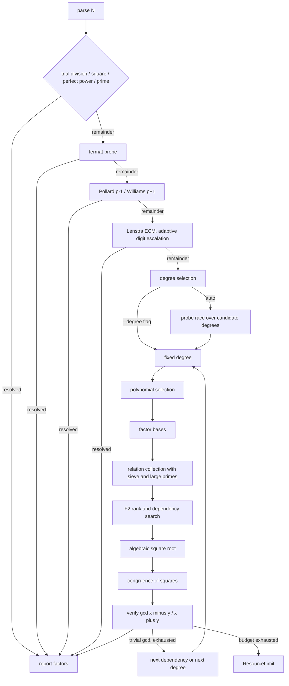

# GrayNFS · [](CHANGELOG.md) [](LICENSE.md) [](https://github.com/jake1104/GrayNFS/actions/workflows/ci.yml) [](python/graynfs/__init__.py)

Pure-Rust GNFS implementation (degrees 2-5) with trial division, Fermat, p-1/p+1, ECM front stages; the fastest verified answer wins.

- **Adaptive cascade:** trial division, perfect powers, Fermat, Pollard p-1, Williams p+1, Brent Rho, Lenstra ECM, SIQS at degree 2, GNFS at degrees 3-5. Measured cost picks the winner; the fastest correct answer wins.
- **Verified output:** every reported factorization is product-checked before it is returned. A wrong answer is a hard failure, never a slow one.
- **Budgets as errors:** time (`--timeout-seconds`) and memory (`--max-memory-mb`, default 1 GiB) end runs with a clean `ResourceLimit`, never an abort.
- **Reproducible bench:** every bench JSON is an archive envelope carrying its own provenance (task ID, tier, timeout, threads, seeds, timestamp).

The numeric backend is `num-bigint` / `num-traits` (no GMP: the Windows MSVC linker cannot build it). The CLI binary uses `mimalloc` by default; the Python wheel is unaffected.

- [Quick start](#quick-start)
- [Installation](#installation)
- [CLI usage](#cli-usage)
- [Python usage](#python-usage)
- [Benchmarks](#benchmarks)
- [Architecture](#architecture)
- [Correctness](#correctness)
- [Building and testing](#building-and-testing)
- [Contributing](#contributing)
- [Release notes](#release-notes)
- [License](#license)

## Quick start

```powershell
cargo build -p graynfs-cli --release
.\target\release\graynfs.exe 100160063
```

```text
N: 100160063
method: fermat
degree: n/a
factors: 10007 * 10009
relations: 0
rank: 0
elapsed_ms: 1
```

```python
>>> import graynfs
>>> graynfs.factor(100160063)
[10007, 10009]
```

## Installation

Prerequisites: a Rust stable toolchain plus a C compiler (the default allocator builds C sources; `--no-default-features` skips it), Python 3.8 or later, and maturin for the wheel.

```powershell
cargo build -p graynfs-cli --release
.\target\release\graynfs.exe 1000036000099
python -m maturin build --release --out dist
python -m pip install --force-reinstall --no-deps dist\graynfs-0.2.4-cp38-abi3-win_amd64.whl
```

## CLI usage

### Factoring one integer

```text
> graynfs.exe 100160063 --timings
N: 100160063
method: fermat
degree: n/a
factors: 10007 * 10009
relations: 0
rank: 0
elapsed_ms: 0
stage: trial_division       degree: n/a  elapsed_ms: 0        checked=1229
stage: fermat               degree: n/a  elapsed_ms: 0        divisor=10007
```

### JSON output

With `--json` the report is a single JSON object on stdout with keys `input`, `method`, `degree` (nullable), `factors` (decimal strings), `factor_confidence`, `polynomial` (nullable), `root` (nullable), `relations`, `rank`, and `elapsed_ms`, plus a `timings` array of `{stage, degree, elapsed_ms, detail}` only when `--timings` is also passed. A failed run instead emits `{"error": {"category": ..., "detail": ...}}` and exits 1; a run that fails before `N` parses carries no `timings` key even with `--timings`.

```json
{"degree":null,"elapsed_ms":0,"factor_confidence":["proven_prime","proven_prime"],"factors":["10007","10009"],"input":"100160063","method":"fermat","polynomial":null,"rank":0,"relations":0,"root":null}
```

With `--progress`, per-event lines stream to stderr while stdout keeps the final report (or pure `--json`). The CPU cap is charged as allocated wall-clock multiplied by threads at the existing checkpoints, so it trips in seconds rather than at the wall-clock timeout.

### Batch mode

`graynfs batch --input numbers.txt` factors one integer per line, streaming one JSON object per line to stdout. Each record carries keys `input`, `factors` (decimal strings), `status` (`ok` or `error`), `method` (present on success), `elapsed_ms`, and `error` (`null` on success, `"<category>: <detail>"` on failure). Per-input results and timings are independent; `--continue-on-error` records a bad line and keeps going instead of aborting the whole run, and `--jsonl` selects the JSON Lines encoding explicitly.

```text
> graynfs.exe batch --input numbers.txt --continue-on-error
{"elapsed_ms":0,"error":null,"factors":["10007","10009"],"input":"100160063","method":"fermat","status":"ok"}
{"elapsed_ms":0,"error":null,"factors":["3","5"],"input":"15","method":"trial_division","status":"ok"}
{"elapsed_ms":0,"error":"invalid decimal integer: invalid digit found in string","factors":[],"input":"abc","method":null,"status":"error"}
```

Exit code is 0 only when every line succeeds; any failure — or a cancellation — exits 1.

### Interrupting a run

Ctrl+C cancels the run through the same `cancelled` checkpoint the engines already poll: the CLI prints `error: cancelled: the operation was cancelled` on stderr and exits 1. In batch mode the line in flight records a `cancelled` error and the command exits 1 without starting further lines.

### Exit codes

- Exit code is 0 on success and 1 on failure (invalid input, budget expiry, cancellation, internal error).
- A failed run prints `error: <category>: <detail>` on stderr (verified: `error: input: invalid
decimal integer: ...` for `abc`; `error: resource-limit: ...` on budget
expiry), where `category` is one of `input`, `resource-limit`,
`cancelled`, or `internal`. `cancelled` is reported when a run is
cancelled: Ctrl+C on the CLI, or a falsy return from a Python progress
callback.
- With `--timings`, stage records print on stdout even for failed runs, except runs that fail before `N` parses (e.g. an invalid decimal): those never carry `timings`.

### Full CLI flag table

<details>
<summary>All flags with defaults</summary>

| flag | default | meaning |
| :--- | :------ | :------ |
| `--degree` | auto | force a fixed polynomial degree (see Degree selection below) |
| `--rational-base-bound` | 2000 | bound of the rational factor base |
| `--algebraic-base-bound` | 2000 | bound of the algebraic factor base |
| `--sieve-a-bound` | 700 | sieve bound on `a` |
| `--sieve-b-bound` | 120 | sieve bound on `b` |
| `--large-prime-bound` | 50000 | upper bound of a residual large prime |
| `--seed` | absent (0x9e3779b97f4a7c15) | seed for the deterministic RNG |
| `--timeout-seconds` | 60 | overall budget; on expiry the run ends with a clean `ResourceLimit` and exit code 1 |
| `--max-memory-mb` | unset (1 GiB budget) | cap estimated sieve and matrix memory in MiB before allocating; exceeded estimates fail cleanly with `ResourceLimit` instead of allocating |
| `--max-cpu-seconds` | unset (no budget) | process-wide CPU-time budget in seconds approximated as allocated wall-clock multiplied by threads (not OS-measured process CPU time), enforced at stage and collect-loop checkpoints rather than as a hard real-time limit; on expiry the run ends with a clean `ResourceLimit` |
| `--no-fallback` | off | disable the Pollard-Rho fallback |
| `--skip-preprocessing` | off | skip trial division and the Fermat/p-1/p+1/ECM probes; the perfect-square and perfect-power reductions still run |
| `--double-large-primes` | off | keep relations carrying two or three large primes and pair them cyclically; raises the yield on very large inputs but slows collection at smaller ones |
| `--no-fermat` | off | skip the Fermat close-factor probe |
| `--no-pm1` | off | skip Pollard p-1 |
| `--no-pp1` | off | skip Williams p+1 |
| `--no-ecm` | off | skip Lenstra ECM |
| `--no-mpqs` | off | route degree 2 to the classic single-polynomial QS path instead of SIQS |
| `--timings` | off | print a per-stage timing breakdown |
| `--threads` | all logical cores | worker thread count for the parallel stages |
| `--perf-mode` | off | mark timing records as performance-mode runs without changing factorization behavior |
| `--json` | off | emit the result as a single JSON object on stdout |
| `--progress` | off | stream per-event factorization progress to stderr (`--json` stdout stays pure) |

</details>

Bounds left at the defaults are auto-scaled:

- Inputs above 36 digits use a digit-indexed parameter table (memory-bounded to 1 GiB with a clean `ResourceLimit`); passing any bound explicitly keeps it.
- The 37-60 digit rows share one uncapped table entry.
- The degree-2 collect loop also escalates the sieve width on starvation (measured `InsufficientRelations` rounds only, explicit flags still win).

The report prints the input, the method, the selected degree, the verified
factors, the relation count, the matrix rank, and the elapsed milliseconds.

### Degree selection

`FactorOptions::degree` is `Option<usize>`: `None` selects automatically,
`Some(d)` forces degree `d`. `candidate_degrees` derives candidates from the
bit length of $N$:

| bit length of $N$ | candidates |
| :---------------- | :--------- |
| $\le 32$ | `[2]` |
| $33$–$35$ | `[2]` |
| $\ge 36$ | `[2, 3]` |
| $\ge 44$ | `[2, 3, 4]` |
| $\ge 60$ | `[2, 3, 4, 5]` |

A single candidate runs directly. Otherwise the candidates race:

- Each receives a slice of `degree_race_fraction` (fixed internal at `0.2`, no CLI/Python surface) of the remaining budget, and the first verified divisor wins immediately.
- The probe bound is

$$B(N) = \exp((\ln N)^{1/3}\,(\ln\ln N)^{2/3}\,(64/9)^{1/3})$$

seconds, clamped to one hour, used only when no deadline is configured (the
Python default).
- If every candidate exhausts its slice, the lowest degree
that ran out of time is re-run with the full remaining budget.
- Fixed internals with no CLI/Python surface: `use_gnfs` (`true`), `use_frobenius` (`false`), `polynomial_candidates` (`8`), `degree_race_fraction` (`0.2`, valid `0.05`-`0.5`).
- The CLI default of 60 s keeps unattended runs bounded; the Python default of `None` leaves the deadline to the caller.

## Python usage

### Factoring one integer

```python
import graynfs

graynfs.factor(100160063)                       # [10007, 10009]
graynfs.factor(100160063, degree=3)             # [10007, 10009]
graynfs.factor_report(100160063)["factors"]     # [10007, 10009]
graynfs.factor_report(100160063)["method"]      # 'fermat'
graynfs.is_probable_prime(10007)                # True
graynfs.version()                               # '0.2.4'
graynfs.stage_timings(100160063, degree=3)      # [{'stage': 'fermat', ...}]
```

All outputs above were verified live against the installed 0.2.4 wheel.

### Python keywords at a glance

`graynfs.factor`, `graynfs.factor_with_progress`, `graynfs.stage_timings`, and `graynfs.factor_report` share one keyword surface, all keyword-only after `n`:

| parameter | default | meaning |
| :--- | :------ | :------ |
| `degree` | `None` | auto-select; pass an int to force a fixed degree |
| `rational_base_bound` | 2000 | bound of the rational factor base |
| `algebraic_base_bound` | 2000 | bound of the algebraic factor base |
| `sieve_a_bound` | 700 | sieve bound on `a` |
| `sieve_b_bound` | 120 | sieve bound on `b` |
| `large_prime_bound` | 50000 | upper bound of a residual large prime |
| `timeout_seconds` | `None` | overall budget; `None` = no deadline |
| `max_memory_mb` | `None` | memory cap in MiB; `None` = 1 GiB budget |
| `max_cpu_seconds` | `None` | CPU-time cap in seconds approximated as elapsed wall-clock multiplied by worker count (not OS-measured process CPU time), enforced at stage/collect-loop checkpoints rather than as a hard real-time limit; `None` = no budget |
| `allow_fallback` | `True` | Pollard-Rho fallback on/off |
| `skip_preprocessing` | `False` | skip the trial/Fermat/p-1/p+1/ECM probes |
| `use_fermat`, `use_pm1`, `use_pp1`, `use_ecm`, `use_mpqs` | `True` | per-stage toggles |
| `enable_double_large_primes` | `False` | keep 2- and 3-large-prime relations |
| `seed` | `None` | pin the deterministic RNG |
| `threads` | `None` | worker count; `None` = all logical cores |
| `perf_mode` | `False` | mark timing records without changing behavior |

- Factors return in ascending order as Python ints; the CLI `--json` report carries them as decimal strings.
- `factor_with_progress(n, callback, ...)` calls `callback` with `{stage, current, total, message}` per stage boundary; a non-callable callback raises `TypeError`. Return a falsy value (e.g. `False`) from the callback to cancel the run: the computation stops and a `GrayNFSError` with `category == "cancelled"` is raised. Truthy values and `None` continue. The wrapper requires a callable; the raw `_graynfs.factor_with_progress_decimal` binding accepts `None` and falls back to a plain factor.
- `stage_timings(n, *, ...)` returns `[{stage, degree, elapsed_ms, detail}]`.
- `factor_report(n, *, ...)` runs one call and returns `{factors, factor_confidence, polynomial, root, method, degree, relations, rank, elapsed_ms, timings}`. `polynomial`/`root` carry the GNFS polynomial pair on siever routes and are `None` otherwise.
- Failures raise `GrayNFSError` (a `ValueError`) with byte-identical text:

| `.category` | when |
| :--- | :--- |
| `input` | bad input, e.g. `factor(0)` |
| `resource-limit` | budget expiry, e.g. a timed-out run |
| `cancelled` | the run was cancelled: a progress callback returned a falsy value, or Ctrl+C interrupted the CLI run |
| `internal` | unexpected internal failure |

Bad types raise `TypeError`. The Rust computation releases the Python GIL, so concurrent `factor` calls overlap.

### Per-factor confidence

`factor_report(n)["factor_confidence"]` classifies each reported factor as `proven_prime`, `probable_prime`, or `composite`:

- `proven_prime`: the factor fits in 64 bits and passes the deterministic Miller-Rabin gate — a proof, not a guess.
- `probable_prime`: the factor is above 64 bits and passes BPSW — probable only, never a proof (large-matrix proof tooling is out of scope).
- `composite`: the factor failed the applicable gate. An over-64-bit `is_prime_proof` `False` means unproven, not composite.

```python
>>> graynfs.factor_report(100160063)["factor_confidence"]
['proven_prime', 'proven_prime']
>>> graynfs.factor_report((1 << 127) - 1)["factor_confidence"]
['probable_prime']
```

### Cancelling from a callback

```python
>>> import graynfs
>>> def stop_at_first(event):
...     return False
>>> graynfs.factor_with_progress(15, stop_at_first)
Traceback (most recent call last):
...
graynfs.GrayNFSError: cancelled: the operation was cancelled
```

### Batch factoring, primality, and determinism

- **Batch:** `graynfs.factor_batch(ns, fail_fast=True, ...)` factors a list with the same keywords. It returns one factor list per input; on failure it either raises (`fail_fast=True`) or records the `GrayNFSError` in place (`False`). Verified: `factor_batch([100160063, 10007])` gives `[[10007, 10009], [10007]]`.
- **Primality:** `graynfs.is_probable_prime(n)` is the BPSW gate (probable, not a proof); `is_probable_prime_fast(n, rounds=64)` tunes the Miller-Rabin rounds; `is_prime_proof(n, method='aks')` proves primality up to 64 bits and answers `False` as unproven, not composite, above that cap — `is_probable_prime` tells the two apart (`True` means an unproven prime, `False` means composite). `is_probable_prime` of a negative input returns `False` (not an `input` error), while `factor` rejects `n < 1`. Verified: both gates return `True` for 10007.
- **Determinism:** `seed` pins the deterministic RNG — the same seed repeats the same run (verified twice identical on `3426790303412814276981061`).
- **CPU budget:** `max_cpu_seconds` caps process-wide CPU time (allocated wall-clock multiplied by threads). A 1 s cap on the 267-bit input ends in `resource-limit` in about 0.2 s of wall time instead of running to the 60 s timeout (verified live).

## Benchmarks

Method: default release build (mimalloc default-on), 16 threads, i5-1340P,
measured 2026-10-17 unless noted. Medians of 5 runs; sub-second deltas under
~30 ms and multi-second deltas under ~10% are noise. Every bench run writes its
raw per-case observations to the `--output` JSON file (default
`logs/graynfs-benchmark.json`, local-only) as an archive envelope carrying
its own provenance (`task_id`, tier, timeout, threads, seeds, timestamp).

| case | winner | elapsed |
| :--- | :----- | :------ |
| `770817968652704265841785071059` 100-bit SIQS | SIQS 1878/945 | 195 ms median (175-203 of 5, re-measured 2026-10-24; YAFU re-measured 213 median of 5, tie) |
| 267-bit with a 21-digit factor | ECM | 506 ms median (504-593 at curves=112, re-measured 2026-10-24; YAFU re-measured 1194 median of 5, gray leads) |
| `3426790303412814276981061` 82-bit | default p-1 | ~12 ms |
| hostile far-apart 105-bit, forced degree-2 | historical 3269/907: ~2.2 s median; standing 1177/926 (full cascade wins via ECM in ~205 ms) | see standing split below |
| 267-bit at `--timeout-seconds 1` | ECM | historical 5/5 (393-473 ms); re-verified 3/5 (676-692 ms, n=5) |

Hostile 105-bit standing split: the `3269/907` hostile rows in the summary table above and the full table below are the historical identity (`~2.2 s` median era); the standing forced-degree-2 identity is `1177/926`. Current CI smoke gate (release, 16 threads, medians of 5, binary `191928cea133ce1a`, 2026-11-01): `1177/926` SIQS `619.0 ms` median of 5 (reps `616.0/644.0/619.0/627.0/614.0`, upper-only ref `3432.0`, limit `4290.0`, PASS, product-verified 5/5); the 2026-10-31 gate on binary `29bf0842aef49b97` (`645.0 ms` median of 5, reps `622.0/645.0/612.0/682.0/694.0`) is historical. The same input resolves via ECM on the default route.

### Full benchmark tables

Degree 2 is SIQS (self-initializing polynomials over the QS sieve infra:
target `A ≈ 2^(n_bits/2 + 1 - interval_bits)`, CRT-built `B` with `B² ≡ N
(mod A)`, per-attempt base/sieve expansion x2 up to 4 attempts, and
one-large-prime pairing preserving `a² ≡ value (mod n)`). The MR primality
test on residuals is gated behind `rest ≤ large_prime_bound`. On starvation
(measured `InsufficientRelations` rounds only) the collect loop escalates the
sieve width over a fixed grid at the default LP bound.

| case | flags | relations | rank | elapsed |
| :--- | :---- | :-------- | :--- | :------ |
| `1000036000099 = 1000003 * 1000033` | default | n/a (preprocessing win, no sieve) | n/a | 0 ms, Fermat win (single) |
| `100160063 = 10007 * 10009` | `--skip-preprocessing --degree 3` | 604 | 293 | 120 ms historical row, kept for reference |
| `1155285037654380637 = 1074741869 * 1074941873` | `--skip-preprocessing --degree 3` | 3682 | 2422 | 1702 ms total, collect 1133 ms, rank 56 ms (historical single-draw; standing identity 3023/2160) |
| `100160063 = 10007 * 10009` | `--skip-preprocessing --degree 4` | 934 | 549 | 225 ms (single) |
| `4606404410723 = 2048581 * 2248583` | `--skip-preprocessing --degree 5` + bounds below | 4265 | 2810 | 8224 ms total, collect 519 ms, rank 64 ms (single) |
| `770817968652704265841785071059` | `--skip-preprocessing --degree 2` | 1878 | 945 | total 208-233 ms, median 229 (of 3) |
| `3426790303412814276981061` | `--skip-preprocessing --degree 2` | 301 | 251 | 35 ms total (single) |
| `35658606617546370626847644936101` hostile far-apart | `--skip-preprocessing --degree 2` | 3269 | 907 | 2174 ms median (of 3), historical; standing 1177/926 |

The deg5 row used `--rational-base-bound 4000 --algebraic-base-bound 20000
--sieve-a-bound 72000 --sieve-b-bound 8000`.

| case | winner | elapsed |
| :--- | :----- | :------ |
| `1000036000099 = 1000003 * 1000033` (close) | Fermat | 0 ms (single) |
| `1155285037654380637` 61-bit | Fermat | 0 ms (single; GNFS path historical: 1702 ms at 3682/2422) |
| `726421589145731 = 5467499 * 132861769` | p+1 after Fermat/p-1 misses | 753 ms historical row |
| `28336447260686263324663` 76-bit | p+1 | 3191 ms historical row |
| 267-bit (above) | ECM after Fermat/p±1 misses | 506 ms median (of 5, re-measured 2026-10-24; 859 of 3 kept as historical) |
| same 267-bit at `--timeout-seconds 1` | ECM | 5/5 wins, 393-473 ms (historical) / 3/5 wins, 676-692 ms (re-measured 2026-10-17) |
| `768805586871186146129` 70-bit | SIQS | 27 ms historical row |
| `3426790303412814276981061` 82-bit | SIQS forced route / p-1 default route | 35 ms / 12 ms (single) |
| `768805586871186146129` 70-bit | p-1 after Fermat miss | 13 ms (single) |

External reference (YAFU 3.1.9 static AVX2 restored 2026-10-24, 16 threads,
identical inputs; both sides re-measured 2026-10-24, release, medians of 5;
raw logs retained with the measurement task, historical 2026-10-17 5-run set superseded but kept):
100-bit forced-SIQS gray 195 ms median (175/195/203) vs YAFU re-measured
174-286 ms (median 213 of 5), a tie within the ±20 ms noise rule and YAFU's own
spread. Demo267 gray 506 ms median (504/506/579, curves=112) vs YAFU
re-measured 1194 ms median of 5 (772-1550), gray leads.

### 267-bit repro case

The `stress` tier ends with `repro_267`, the 267-bit ECM input
`166871515843890537614148105919789085907512212182703922830333764223351416812060867`
($121680281986369904489 \times 1371393237423486234387340775961402466614689310566958802486603$,
product-verified). It carries its own 60 s deadline regardless of
`--timeout-seconds`, and every bench run writes its raw per-case observations
to the `--output` JSON file as an archive envelope: top-level provenance
(`task_id`, `tier`, `timeout_seconds`, `threads_requested`,
`threads_effective`, `case_filter`, the `random_*` seed settings, and
`timestamp_unix_secs`) plus the `observations` array. `--task-id` labels the
envelope.

```powershell
target\release\graynfs-bench.exe --tier repro267 --timeout-seconds 60 `
  --task-id repro267 `
  --output bench-repro267.json
```

Measured 2026-10-17 (release, 16 threads): `repro_267` status ok, verified
true, method `ecm`, total ~715 ms against the 60 s per-case deadline.

### Limits

Hard walls:

- The square-root tail is mechanically bounded: a 12 s per-attempt ceiling
(`ATTEMPT_CEILING_MS`, verified-gcd soundness kept) cut the deg3-skip median
5.1x.
- Degree 6 is implemented and unit-tested but deliberately not a
candidate (Dickman parameter $u \approx 10$, $\rho(u) \approx 10^{-11}$).
- The SIQS wall stood between 100 and 105 bits; starvation-gated width
escalation closed the 105-bit cell (3269/907 historical in ~2.2 s median on the
forced-degree-2 route; standing identity 1177/926 at a 619.0 ms CI median of 5),
while 110-bit+ and 90-digit inputs remain out of
reach (smoothness wall). Lattice sieving is not implemented.
- The memory budget is an estimate-based soft guard, not an RSS hard limit.
- The quintic forced-path test covers 27-bit 100160063 only, not larger-input efficiency.
- The 105-bit quarantine stays non-blocking with owner/review recorded. Knife-edge cells of the b70-deg3 kind require a longer explicit budget before any reproduced-number claim.

How work splits:

- There are no absolute bit-size dispatch boundaries: budgets are fractional slices of the
remaining time and escalation follows measured cost.
- The cascade splits work by factor character: smooth `p-1`/`p+1` to Pollard/Williams, close factors to
Fermat, small factors to Brent Rho and ECM (Montgomery XZ, PRAC chains,
unrolled REDC, prime-only stage-2 BSGS, 16-thread curves, stage-2 cap 16M),
balanced mid-size inputs to the siever or the GNFS degree race, leftovers to
the Rho fallback.
- Default-path wins on small and medium inputs come from the cascade stages (trial division, Fermat, p-1/p+1, ECM, SIQS); for example, the 61-bit `1155285037654380637` row already records `Fermat 0 ms` on the default route against `1702 ms` on the forced degree-3 GNFS route. Forced degree-3+ GNFS routes are for research and comparison via `--skip-preprocessing --degree d`; the 105-bit hostile cell keeps `~2.2 s` (`3269/907`) as the historical forced-degree-2 figure against the standing `1177/926` (`619.0 ms` CI median of 5), and the full cascade resolves the same input via ECM in `~205 ms`.
- The per-stage `race_pilot` (`relations=`/`err=`) and `race_escalation` (`pick=`/`rate=`) timing records show which degree actually contended.

Frozen per-cell winners (frozen-corpus medians, copied exactly, no recomputation):

| member | route | method | median |
| --- | --- | --- | --- |
| b70 | default | pm1 | 15.5 ms |
| deg3skip | default | fermat | 0 ms |
| bit82 | default | pm1 | 19 ms |
| bit100 | default | ecm | 167.5 ms |
| hostile105 | default | ecm | 170.5 ms |
| demo267 | default | ecm | 1130.5 ms |

GNFS 0/6 default-path: no frozen-corpus member is won by GNFS on the default route. This claim holds for the 6-member frozen corpus only, not for general inputs.

Forced-route matrix evidence (completed 150-run GNFS matrix, 6 cells x 5 routes x 5 reps): the deg3skip forced degree-3 matrix identity `3677/2419` (5/5, with `3682/2422` kept as a historical single-draw) is historical after the 10.3 excess-drain retune; the standing identity is `3023/2160`; b70 forced degree-3 recorded `5062/3698` observed-only (`5981/3966` historical) at 5/5 deterministic, explicitly not a pin; deg3skip degree-2 240/145 stands as a pin; degree-4/5 clean failures split into relation-deadline burn versus 1024 MiB sieve-precheck instant reject. Matrix source and run conditions: one JSON envelope per run (150/150, overall COMPLETE), release build (`b5f8293df9903b39`), 16 threads, sequential machine-idle with a STOP check before every spawn, per-cell CLI timeouts of 30 s (b70, bit82, deg3skip) and 60 s (bit100, hostile105) with a 20 s demo267 forced-degree-3+ timeout, binary-default seed `0x9E3779B97F4A7C15` not forwarded. Hostile105-degree-2 follow-up: the matrix identity `3269/907` (5/5) is historical; the standing identity is `1177/926` with identical factors, and the current CI smoke gate records a `619.0 ms` median of 5 on release binary `191928cea133ce1a` (16 threads, reps `616.0/644.0/619.0/627.0/614.0`, upper-only ref `3432.0`, limit `4290.0`, PASS, product-verified 5/5; prior `645.0 ms` median on `29bf0842aef49b97` historical). b70-degree-3 stays observed-only at 5/5 deterministic, explicitly not a pin.

Current CI smoke (release, 16 threads, medians of 5, binary `191928cea133ce1a`, 2026-11-01, 4/4 PASS, every rep product-verified): bit100-deg2 SIQS 1878/945 median `165.0 ms` (limit `322.5`), bit100-default ECM median `84.0 ms` (limit `197.5`), hostile105-deg2 SIQS 1177/926 median `619.0 ms` (upper-only ref `3432.0`, limit `4290.0`), deg3skip-deg2 SIQS 240/145 median `10.0 ms` (limit `45.0`).

Why not (investigated, declined with measurement):

| idea | verdict |
| :--- | :------ |
| Lattice sieving + special-q + buckets + FK medium jumps | Declined: enumeration without a residual gate starves the classifier (production-scale 0/20553 miss sealed); residual-gated twin measured paired-usable-per-ms delta `<= 0` everywhere, so no engine work follows. |
| Wider large-prime bounds / 3-LP by default | Refused: measured LP slope flat (one extra usable relation at ~33x cost); the `lp^2` gate and the 1M splitter cap stay. |
| GNFS-first or a lowered crossover | Refused: the corpus sits at 18-91 digits, far below the ~97-digit GNFS floor; forced degree-3 on small inputs trickles (33 usable relations in 67 s) or rejects at estimation time. |
| Filtering (singleton / clique / merge) | LANDED in-engine: singleton/doubles product-merge runs before rank; rank-identical with the excess preserved, and the standing deg3skip-deg3 identity `3023/2160` reflects the retuned filter. Offline-only bulk clique/component splits stay out: recorded matrices form a single component each, so no split gain was measured (pre-merge baseline, historical: decisive runs stayed `rows <= columns` with rank ~1.7% of the cell; the bar was a smaller output with >=2x rank/slab win). |
| Block Wiedemann / block Lanczos | STOP: largest recorded matrix 5981x3977 with rank 443 ms vs smallest published sparse-LA deployment ~430k columns (~100x gap); per-step Gram overhead matches the measured penalty, so re-entry needs rank at >=15% of a reachable cell first. |
| Characters + excess policy | Deferred until abundance: with rank-deficient (dependency-poor) cells first, the post-linear-algebra second-character filter only pays after dependencies are plentiful. |
| Polynomial score-only refinements (Murphy-E style) | No-hope as score-only: uncalibrated E over-predicts measured relations 7.6x (deg3skip) / 33.9x (b70); only short-sieve measured yield closes the loop, never a better static formula. |
| GPU / RNS / AVX matrix multiply, parallel lingen | Wrong regime: `N < 6000` dense streaming wins; the Krylov-dominant tooling targets `N ~ 1e8` with months-scale cost. |
| Large sieve region (`I = 2^14-2^16`), multi-process sieve net, distributed savefiles | Opposite direction: the estimate already refuses above 1024 MiB before sieving starts, and the longest cell is a 120 s timeout, not a days-long sieve. |
| Degree 6 / JLSV / GJL / high-skewness machinery | Out of range: degree 6 is implemented and unit-tested but stays off the candidate list (Dickman `u ~= 10`, `rho(u) ~= 1e-11`); the heavyweight selection machinery targets 768-bit+ inputs. |
| APR-CL proof on the hot path | Out of scope: BPSW stays the default prime gate (deterministic for u64) with opt-in AKS capped at 64 bits; large-matrix proof tooling activates past sizes never built here. |

## Architecture



| crate | role |
| :---- | :--- |
| `graynfs-core` | GNFS implementation (SIQS degree 2 with QS fallback, GNFS degrees 3-5 as one engine) with trial division, Fermat, p-1/p+1, ECM front stages, preprocessing, sieving, F2 linear algebra, algebraic square root, record-only SNFS special-form detector |
| `graynfs-cli` | `graynfs <N>` command-line front end |
| `graynfs-py` | PyO3 extension module exposed as the `graynfs` Python package |
| `graynfs-bench` | benchmark tiers with per-case deadlines and JSON output |



## Correctness

```powershell
cargo test --workspace
python -m pytest -q python/tests
```

- Every bench and every run self-checks the product before reporting success, with final factors product-verified under probabilistic primality.
- BPSW is the default prime gate: deterministic for u64, probable (not a proof) otherwise. Only the opt-in AKS path proves primality, capped at 64 bits and never on the hot factoring path. An over-cap AKS `False` means unproven, not composite: `is_probable_prime` reads `True` for an unproven prime and `False` for a composite.
- `graynfs-bench --tier random` generates reproducible semiprimes with a seeded
SplitMix64 generator and verifies every answer:

```powershell
target\release\graynfs-bench.exe --tier random --random-count 60 `
  --random-min-factor-bits 16 --random-max-factor-bits 24 --timeout-seconds 180
```

Sixty cases spanning 34 to 48 bits all factor correctly on earlier trees, and
no case ever produced a wrong answer:

- Every failure was a clean `ResourceLimit`.
- Re-verified on the current tree 2026-10-17: far-apart 16/16 and random 35/35, zero failures, all products verified.

## Building and testing

```powershell
cargo fmt --all
cargo clippy --workspace --all-targets -- -D warnings
cargo test --workspace
```

`mimalloc` is the default allocator for `graynfs-cli`. Single-machine
evidence only. Opt out explicitly:

```powershell
cargo build -p graynfs-cli --release --no-default-features
```

Release, wheel, and Python suite:

```powershell
cargo build -p graynfs-cli --release
python -m maturin build --release --out dist
python -m pip install --force-reinstall --no-deps dist\graynfs-0.2.4-cp38-abi3-win_amd64.whl
python -m pytest -q python/tests
```

`gate.ps1 -Full` runs the full local gate in CI step order (fmt, clippy, test, release build, quarantine, wheel build + install, pytest, version guard, API surface, invariants, degree spot-checks, perf smoke).

## Contributing

- Report bugs and request features via [issues](https://github.com/jake1104/GrayNFS/issues).
- Review [pull requests](https://github.com/jake1104/GrayNFS/pulls) and the benchmark method notes before trusting a timing row.
- Build and test locally first (`cargo fmt --check`, `cargo clippy --workspace --all-targets -- -D warnings`, `cargo test --workspace`, `cargo build --release`); see `gate.ps1` for the full local gate including the wheel and the release-only quarantine test.
- Keep changes minimal and measured: one behavior per task, with the commands and outputs that prove it.

## Release notes

Release notes live in [GitHub Releases](https://github.com/jake1104/GrayNFS/releases).

## License

MIT (see [LICENSE.md](LICENSE.md)).
