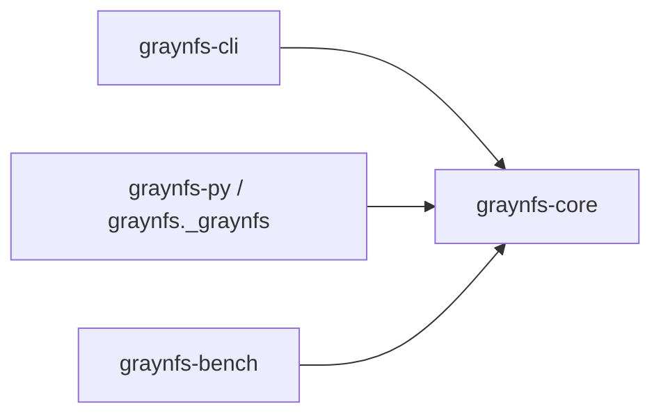
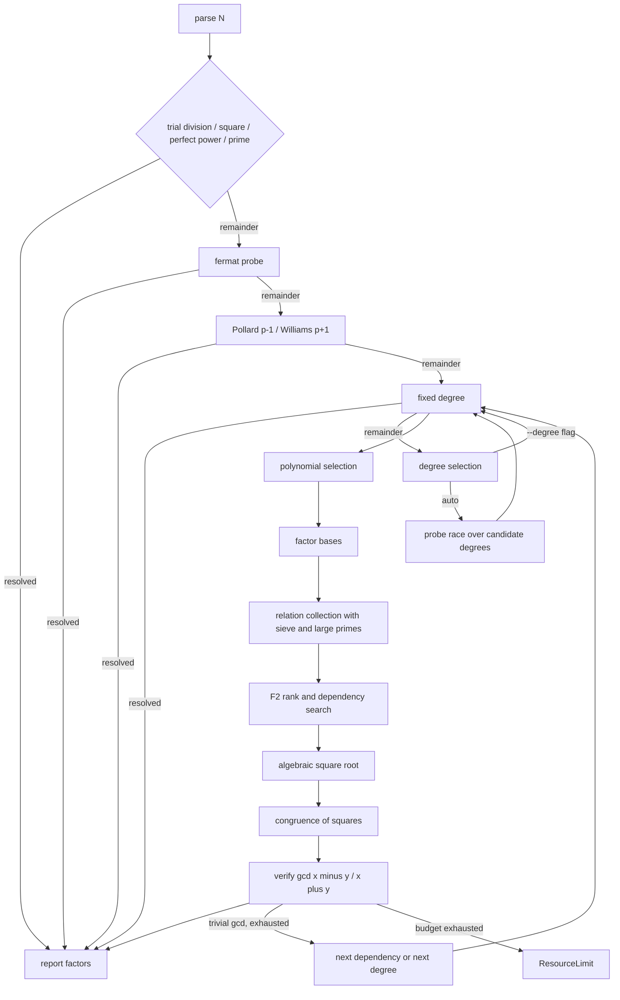

# GrayNFS


Integer factorization in Rust, with a command-line interface and a
PyO3/maturin Python binding. The project started as a General Number Field
Sieve implementation, which remains the primary general-purpose engine, and
grew an adaptive cascade around it: trial division, perfect powers, Fermat,
Pollard p-1, Williams p+1, Pollard-Rho (Brent), Lenstra ECM, the SIQS stage
at degree 2 (single-polynomial QS as fallback) and GNFS at degrees 3-5. A
natural number input is routed through these stages by measured cost; the
fastest correct answer wins.

The numeric backend is `num-bigint` / `num-traits`. The GMP backend is not used,
because the Windows MSVC linker cannot build it. The CLI binary uses
`mimalloc` as its default allocator; the Python wheel is unaffected (no
allocator path into it).

- [Installation](#installation)
- [Quick start](#quick-start)
- [Workspace layout](#workspace-layout)
- [Pipeline](#pipeline)
- [Command line](#command-line)
- [Python](#python)
- [Benchmarks](#benchmarks)
- [Correctness](#correctness)
- [Building](#building)
- [License](#license)

## Release notes (v0.1.0 — 2026-10-17)

First release. Integer factorization through an adaptive cascade (trial
division, perfect powers, Fermat, Pollard p-1/p+1, Brent Rho, Lenstra ECM,
SIQS at degree 2, GNFS at degrees 3-5) around a GNFS core, with a CLI and a
Python binding. Pure-Rust arithmetic, default allocator mimalloc, MIT
licensed. Install from [Installation](#installation).

Measured (i5-1340P, 16 threads — details in [Benchmarks](#benchmarks):
100-bit SIQS ~180-240 ms; 267-bit ECM case ~533 ms (same input: YAFU 3.1.9
~836 ms); 82-bit default route ~12 ms; 105-bit hostile semiprime ~2.2 s;
tight 1 s budget on the 267-bit case won 5/5. Every reported factorization
is product-verified before it is returned.

Known limits: hostile inputs past ~105 balanced bits and all tested 90-digit
inputs are out of reach (smoothness wall); all timings are single-machine
evidence; Windows MSVC is the tested toolchain.

## Installation

Prerequisites: a Rust stable toolchain plus a C compiler (the default
allocator builds C sources; `--no-default-features` skips it), Python 3.8 or
later, and maturin for the wheel.

```powershell
cargo build -p graynfs-cli --release
.\target\release\graynfs.exe 1000036000099
python -m maturin build --release --out dist
python -m pip install --force-reinstall --no-deps dist\graynfs-0.1.0-cp38-abi3-win_amd64.whl
```

## Quick start

```text
> graynfs.exe 100160063
N: 100160063
method: preprocessing
degree: n/a
factors: 10007 * 10009
relations: 0
rank: 0
elapsed_ms: 0
```

```text
> graynfs.exe 100160063 --timings
N: 100160063
method: preprocessing
degree: n/a
factors: 10007 * 10009
relations: 0
rank: 0
elapsed_ms: 0
stage: fermat               degree: n/a  elapsed_ms: 0        divisor=10007
```

```python
>>> import graynfs
>>> graynfs.factor(100160063)
[10007, 10009]
```

## Workspace layout



| crate | role |
| :---- | :--- |
| `graynfs-core` | factorization library: adaptive cascade (`cascade`, `pm1`, `ecm`), preprocessing, sieving (SIQS degree 2 with QS fallback, GNFS degrees 3-5), F2 linear algebra, algebraic square root, record-only SNFS special-form detector |
| `graynfs-cli` | `graynfs <N>` command-line front end |
| `graynfs-py` | PyO3 extension module exposed as the `graynfs` Python package |
| `graynfs-bench` | benchmark tiers with per-case deadlines and JSON output |

## Pipeline



## Command line

| flag | default | meaning |
| :--- | :------ | :------ |
| `--degree` | auto | force a fixed polynomial degree (see Degree selection below) |
| `--rational-base-bound` | 2000 | bound of the rational factor base |
| `--algebraic-base-bound` | 2000 | bound of the algebraic factor base |
| `--sieve-a-bound` | 700 | sieve bound on `a` |
| `--sieve-b-bound` | 120 | sieve bound on `b` |
| `--large-prime-bound` | 50000 | upper bound of a residual large prime |
| `--timeout-seconds` | 60 | overall budget; on expiry the run ends with a clean `ResourceLimit` and a non-zero exit |
| `--no-fallback` | off | disable the Pollard-Rho fallback |
| `--skip-preprocessing` | off | skip trial division and the Fermat/p-1/p+1/ECM probes; the perfect-square and perfect-power reductions still run |
| `--double-large-primes` | off | keep relations carrying two or three large primes and pair them cyclically; raises the yield on very large inputs but slows collection at smaller ones |
| `--no-fermat` | off | skip the Fermat close-factor probe |
| `--no-squfof` | off | reserved; no Squfof stage is currently landed |
| `--no-pm1` | off | skip Pollard p-1 |
| `--no-pp1` | off | skip Williams p+1 |
| `--no-ecm` | off | skip Lenstra ECM |
| `--no-mpqs` | off | route degree 2 to the classic single-polynomial QS path instead of SIQS |
| `--timings` | off | print a per-stage timing breakdown |
| `--threads` | all logical cores | worker thread count for the parallel stages |
| `--perf-mode` | off | mark timing records as performance-mode runs without changing factorization behavior |
| `--json` | off | emit the result as a single JSON object on stdout |

Bounds left at the defaults are auto-scaled by a digit-indexed parameter table
for inputs above 36 digits (msieve-reference interval, large-prime and A-factor
shape at the 80-digit row, memory-bounded to a 1 GiB budget with a clean
`ResourceLimit` instead of an abort); passing any bound explicitly keeps it.
The 37-60 digit rows share one uncapped table entry, and the degree-2 collect
loop also escalates the sieve width on starvation (measured
`InsufficientRelations` rounds only, LP bound untouched, explicit flags still win).

The report prints the input, the method, the selected degree, the verified
factors, the relation count, the matrix rank, and the elapsed milliseconds.
Every run also self-checks that the reported factors multiply back to the
input before reporting success.

Exit code is 0 on success and non-zero on failure. A failed run prints
`error: <category>: <detail>` on stderr (verified: `error: input: invalid
decimal integer: ...` for `abc`; `error: resource-limit: ...` on budget
expiry), where `category` is one of `input`, `resource-limit`,
`cancelled`, or `internal`. With `--timings`, the collected stage records
print on stdout even for failed runs.

With `--json` the same fields are emitted as a single JSON object with keys
`input`, `method`, `degree` (nullable), `factors`, `relations`, `rank`, and
`elapsed_ms`, plus a `timings` array of `{stage, degree, elapsed_ms, detail}`
objects only when `--timings` is also passed. A failed run instead emits
`{"error": {"category": ..., "detail": ...}}` on stdout and exits non-zero.
Verified output:

```json
{"degree":null,"elapsed_ms":0,"factors":["10007","10009"],"input":"100160063","method":"preprocessing","rank":0,"relations":0}
```

### Degree selection

Degree selection is automatic by default. `FactorOptions::degree` is an
`Option<usize>`:

- `None` selects the degree automatically.
- `Some(d)` forces degree `d`.

`candidate_degrees` derives the candidates from the bit length of $N$:

| bit length of $N$ | candidates |
| :---------------- | :--------- |
| $\le 32$ | `[2]` |
| $\ge 36$ | `[2, 3]` |
| $\ge 44$ | `[2, 3, 4]` |
| $\ge 60$ | `[2, 3, 4, 5]` |

A single candidate skips the race and runs directly. Otherwise the candidates
race: each receives a slice of `degree_race_fraction` (default `0.2`) of the
remaining budget, and the first candidate that returns a verified divisor wins
immediately.

The probe bound is

$$B(N) = \exp\left((\ln N)^{1/3}\,(\ln\ln N)^{2/3}\,(64/9)^{1/3}\right)$$

seconds, clamped to one hour. It is used only when no deadline is configured,
which is the case for the Python API at its default `timeout_seconds=None`.
Without it the first candidate would consume an unbounded slice.

If every candidate exhausts its slice, the lowest degree that ran out of time is
re-run with the full remaining budget, so a tight race fraction can cost time
but never turns a solvable input into a failure.

## Python

```python
import graynfs

graynfs.factor(100160063)                       # [10007, 10009]
graynfs.factor(100160063, degree=3)             # [10007, 10009]
graynfs.is_probable_prime(10007)                # True
graynfs.version()                               # '0.1.0'
graynfs.stage_timings(100160063, degree=3)      # [{'stage': 'fermat', ...}]
```

All three outputs above were verified live against the installed 0.1.0 wheel.
`graynfs.factor` and `graynfs.factor_with_progress` accept `degree: int | None
= None`, where `None` selects the degree automatically, plus
`rational_base_bound`, `algebraic_base_bound`, `sieve_a_bound`,
`sieve_b_bound`, `timeout_seconds` (`None` = no deadline, the default),
`allow_fallback`, and the cascade toggles `use_fermat`, `use_squfof`,
`use_pm1`, `use_pp1`, `use_ecm` and `use_mpqs` (all default `True`). All of
these are keyword-only after `n`. The `threads: int | None = None` argument
selects the worker-thread count (default: all logical cores), and `perf_mode:
bool = False` marks timing records as performance-mode runs without changing
factorization behavior. The returned factor list is in ascending numeric order.

`graynfs.factor_with_progress(n, callback, ...)` calls `callback` with a
dictionary holding `stage`, `current`, `total`, and `message` for every stage
boundary, from polynomial selection through the verified congruence of
squares. The callback is the second positional parameter (verified:
`factor_with_progress(100160063, events.append)` returns `[10007, 10009]` and
the first event is `{'stage': 'preprocessing', 'current': 0, 'total': 7,
'message': 'checking primality and small factors'}`); a non-callable callback
raises `TypeError`.

`graynfs.stage_timings(n, *, ...)` takes the same keyword arguments as
`graynfs.factor` and returns a list of dictionaries with `stage`, `degree`
(`None` where no degree applies), `elapsed_ms`, and `detail`. The same
information is available on the command line through `--timings`.

Errors surface as `ValueError` carrying the same category text as the CLI
(verified: `factor(n, timeout_seconds=0)` raises `ValueError: resource limit
exceeded: ...`). Input validation raises `TypeError` for non-integers
(booleans rejected) and `ValueError` for integers below 1; `bool` inputs are
rejected even where the value would be valid.

The Rust computation releases the Python GIL, so concurrent `factor` calls
from multiple Python threads overlap instead of serializing; progress
callbacks re-acquire it per event.

## Benchmarks

Method first: default release build (mimalloc default-on), 16 threads,
i5-1340P, measured 2026-10-17 unless noted. Single runs are labeled as such;
medians are of 5 runs. Sub-second deltas under ~30 ms and multi-second deltas
under ~10% are noise on this machine. A single benchmark is never enough; the
method tag on every row tells how far to trust it.

Degree 2 is SIQS (self-initializing polynomials over the QS
sieve infra: target `A ≈ 2^(n_bits/2 + 1 - interval_bits)`, CRT-built `B`
with `B² ≡ N (mod A)`, per-attempt base/sieve expansion x2 up to 4 attempts,
and one-large-prime pairing: partials whose residual after base-prime division
is a single prime `ℓ ≤ large_prime_bound` merge by shared `ℓ` into
`a_merged = (a1·a2) mod n`, `value = v1·v2`, mask XOR, preserving the
`a² ≡ value (mod n)` invariant the extractor verifies). The MR primality test
on residuals is gated behind `rest ≤ large_prime_bound` so the common case
rejects without an MR round. On starvation (measured `InsufficientRelations`
rounds only) the collect loop escalates the sieve width over a fixed grid at
the default LP bound, with explicit flags still winning.

| case | flags | relations | rank | elapsed |
| :--- | :---- | :-------- | :--- | :------ |
| `1000036000099 = 1000003 * 1000033` | default | n/a (preprocessing win, no sieve) | n/a | 0 ms, Fermat win (single) |
| `100160063 = 10007 * 10009` | `--skip-preprocessing --degree 3` | 604 | 293 | 120 ms historical row, kept for reference |
| `1155285037654380637 = 1074741869 * 1074941873` | `--skip-preprocessing --degree 3` | 3682 | 2422 | 1702 ms total, collect 1133 ms, rank 56 ms (single; square-root tails vary run to run, totals never compared) |
| `100160063 = 10007 * 10009` | `--skip-preprocessing --degree 4` | 934 | 549 | 225 ms (single) |
| `4606404410723 = 2048581 * 2248583` | `--skip-preprocessing --degree 5` + bounds below | 4265 | 2810 | 8224 ms total, collect 519 ms, rank 64 ms (single; totals are square-root-luck dominated) |
| `770817968652704265841785071059` | `--skip-preprocessing --degree 2` | 1878 | 945 | total ~180-240 ms, collect 164 ms, rank 9 ms (two medians of 3: 182 and 236) |
| `3426790303412814276981061` | `--skip-preprocessing --degree 2` | 301 | 251 | 35 ms total, collect 16+16 ms over 2 attempts (single) |
| `35658606617546370626847644936101` hostile far-apart | `--skip-preprocessing --degree 2` | 3269 | 907 | 2174 ms median (of 3; full cascade resolves via ECM in ~205 ms instead) |

The deg5 row used `--rational-base-bound 4000 --algebraic-base-bound 20000
--sieve-a-bound 72000 --sieve-b-bound 8000`.

Cascade highlights (default flags, fastest correct stage wins; GNFS stays the
primary general-purpose engine). All rows re-measured on the current tree:

| case | winner | elapsed |
| :--- | :----- | :------ |
| `1000036000099 = 1000003 * 1000033` (close) | Fermat | 0 ms (single) |
| `1155285037654380637` 61-bit, `\|p-q\|=200004` | Fermat | 0 ms (single; GNFS path: 1702 ms at 3682/2422) |
| `726421589145731 = 5467499 * 132861769` | p+1 after Fermat/p-1 misses | 753 ms historical row, kept for reference |
| `28336447260686263324663` 76-bit | p+1 | 3191 ms historical row, kept for reference |
| `166871515843890537614148105919789085907512212182703922830333764223351416812060867` 267-bit with a 21-digit factor | ECM after Fermat/p±1 misses | 533 ms median (of 3: ECM stage 332 ms at curves=112; YAFU takes ~836 ms on the same input) |
| same 267-bit at `--timeout-seconds 1` | ECM | 5/5 wins, 393-473 ms (of 5) |
| `768805586871186146129` 70-bit | SIQS | 27 ms historical row, kept for reference |
| `3426790303412814276981061` 82-bit | SIQS forced route / p-1 default route | 35 ms / 12 ms (single) |
| `768805586871186146129` 70-bit | p-1 after Fermat miss | 13 ms (single) |

Pre-SIQS single-polynomial QS entries for the same routes, preserved for
history: 70-bit GNFS-2 forced-QS 86.3 s on a clean machine (collect 27.7 s,
rank 48.0 s); 82-bit Rho fallback ~122 s (QS stalls near 10% usable yield).

External reference (YAFU 3.1.9 static AVX2, 16 threads, identical inputs,
re-measured 2026-10-17, 5 runs each side): 100-bit forced-SIQS gray ~180-240
ms vs YAFU 157-218 ms elapsed, a tie within YAFU's own wide spread (the older
290-vs-238 line was the same story at different machine state). Demo267 gray
533 ms median vs YAFU ~836 ms elapsed (559-1198, ECM wins on both sides, same
factor `121680281986369904489`). b70 default was not re-run against YAFU this
round (prior: gray 25 ms pm1 vs YAFU 13 ms rho, noise-band tie). deg3-skip is
unmeasurable as GNFS-vs-GNFS (YAFU answers in 4-5 ms via Fermat pretest, no
GNFS mode). The largest honest gap used to be tight budgets (demo267 at 1 s:
gray 0/5 clean `resource-limit` vs YAFU 7/10 wall-kills); the current tree
wins that cell 5/5.

### Limits

The square-root tail is mechanically bounded: a 12 s per-attempt ceiling
(`ATTEMPT_CEILING_MS`, verified-gcd soundness kept) cut the deg3-skip median
5.1x with winners identical 16/16. Remaining timing variance is scheduling
luck across attempts plus machine state, so multi-second rows above are
reported with their method (single vs median) and totals on tail-dominated
paths are never compared across runs.

Degree 6 is implemented and unit-tested in the solver, but it is deliberately
not a candidate. The wall is the Dickman parameter: degree-6 norms are about
165 bits, so with a base near $2^{16.6}$ the parameter is $u \approx 10$ and
$\rho(u) \approx 10^{-11}$. A 61-bit input with algebraic base 100000 and a
$250000 \times 30000$ sieve collected 947 relations in 240 seconds against a
target of 14860 (596 against 15989 on an earlier tree), and enlarging the base
to 300000 produced none at all.

The SIQS wall stood between 100 and 105 bits at default bounds, and it was
a smoothness limit rather than a time limit. The starvation-gated width
escalation closed the 105-bit cell: a hostile far-apart 105-bit semiprime
(seeded, lpf-stripped) now factors at 3269/907 in ~2.2 s
median (of 3, 2026-10-17) on the forced-degree-2 default path (product
verified), while 110-bit and 120-bit exhausted 600 s the same way when last
measured and 297-bit (90-digit m2) yields zero completed polynomials.
Raising the LP bound was measured flat (usable +6.5% at 37x cost, pairing
conversion 1.34% to 0.23%), so the wall beyond 105 bits is still smoothness,
not throughput.

Lattice sieving, which needs a small-coefficient polynomial, is not implemented:
a monic quadratic with a root near the square root of the input cannot have one,
and the norm form degenerates, so the construction needs a higher-dimensional
knapsack lattice with a two-dimensional enumeration. Reopening it needs a
measured dense-echelon wall or a block-Lanczos implementation with sparse
storage.

The cascade splits the remaining work by factor character: smooth `p-1`/`p+1`
fall to Pollard/Williams stages, close factors to Fermat, small factors of any
size to Brent Rho and then to Lenstra ECM with adaptive digit escalation
(Montgomery XZ arithmetic with PRAC chains and unrolled REDC, prime-only
stage-2 BSGS, 16-thread curves, stage-2 cap 16M, cheap small-B1 tier,
two-tranche miss checkpoint with resume), balanced mid-size inputs to the
quadratic siever or the GNFS degree race, and leftovers to the Rho fallback.
There are no absolute bit-size dispatch boundaries: budgets are fractional
slices of the remaining time and escalation follows measured cost, so each
stage runs exactly while it is the cheapest credible path. SQUFOF and
Murphy-E scoring were attempted and reverted after measurement.

The quadratic siever keeps one-large-prime partials and
pairs them by prime, which multiplied the verified degree-2 yield 3.2x at the
same factors (measured on an earlier tree, kept for reference); with a large
algebraic base that pairing also carries the 64-bit
balanced semiprime, whose smooth yield alone would fall an order of magnitude
short. The quadratic siever runs a single ladder sweep because every lower
threshold was measured re-finding the identical relation set at up to 13x the
cost, and classification reads a divisor bitmap the score walk records instead of
trial-dividing the whole algebraic base: a primitive pair's norm is divisible by a
base prime only if the polynomial has a root there, so the sieve already knows
every divisor. That bitmap is stored block-major, 64 roots at a time into a
contiguous slice, so the marking walk stays in cache instead of scattering a
write per root across the array. The collected set is then filtered before the
matrix is built: relations whose parity mask is all zeros are dropped, which is
safe because a zero row adds nothing to the rank and can be deleted from any null
vector, and a large-prime group is merged strictly in pairs so its prime always
ends up with an even exponent. A group of size k therefore contributes floor(k/2)
relations and an odd leftover is dropped, because a partial carries its large prime
to the first power and an odd number of them never multiplies to a square. Taking
every pair rather than only the first measured faster on the 64-bit case and equal
on verified degree 2 (measured on an earlier tree, kept for reference).
Classification itself switches to word-size division as soon as the residual
fits in one word, which is behaviour-identical.

Bounds are resolved from the input bit length, so the 61-bit row needs no bound
flags, only `--degree 3`: the pure-defaults timing race can pick
degree 2 on some runs, which is not comparable, while the forced degree-3 run uses
the same resolved bounds, 3682 relations and rank 2422. The base and sieve bounds
scale per component, with the algebraic base growing fastest because a general
number field sieve needs a comparatively large algebraic base as the input grows.
An earlier single growth rate for all components left 61-bit inputs short and made
the automatic path report `SearchExhausted` where explicit bounds succeeded.

## Correctness

```powershell
cargo test --workspace
python -m pytest -q python/tests
```

Every reported factorization self-checks that the factors multiply back to the
input before reporting success; a wrong factorization is a hard failure, never
a slow one.

`graynfs-bench --tier random` generates reproducible semiprimes with a seeded
SplitMix64 generator and verifies every answer:

```powershell
target\release\graynfs-bench.exe --tier random --random-count 60 `
  --random-min-factor-bits 16 --random-max-factor-bits 24 --timeout-seconds 180
```

Sixty cases spanning 34 to 48 bits all factor correctly on earlier trees, and no
case ever produced a wrong answer: every failure was a clean `ResourceLimit`.
Re-verified on the current tree 2026-10-17: far-apart
16/16 and random 35/35, zero failures, all products verified.

## Building

```powershell
cargo fmt --all
cargo clippy --workspace --all-targets -- -D warnings
cargo test --workspace
```

`mimalloc` is the default allocator for `graynfs-cli`: three replicated runs
measured 100-bit collect 247 to 161 ms at identical 1878/945 with no
silent-baseline-shift risk. Single-machine evidence only. Opt out explicitly:

```powershell
cargo build -p graynfs-cli --release --no-default-features
```

The workspace is at version `0.1.0`, a pre-release line with no SemVer
compatibility guarantee. v0.1.0 was cut 2026-10-17. Releases are file-based:
a release collects the pending changelog entries under a dated version
heading, bumps `version` in the root `Cargo.toml` (`[workspace.package]`,
inherited by every crate) and in `pyproject.toml`, then builds the wheel with
the command above. No tags are created. Working docs stay out of git by
staging discipline, never via ignore rules.

## License

MIT (see `LICENSE.md`).
